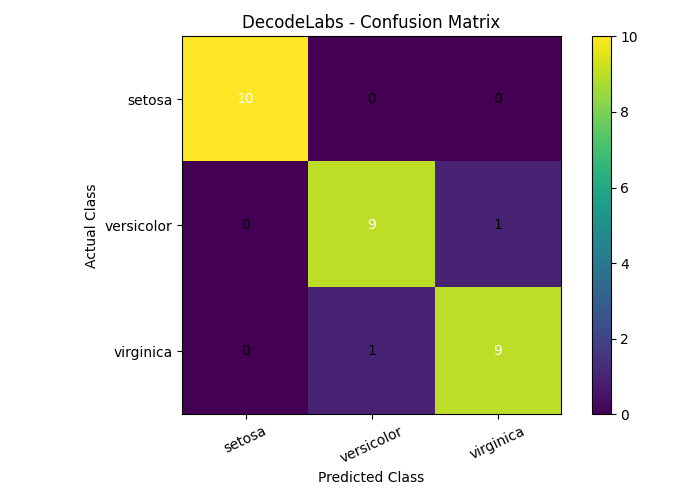

# DecodeLabs AI Internship Project 2
## Data Classification Using AI 🌸

### 📌 Project Overview
This project demonstrates how Artificial Intelligence (AI) and Machine Learning (ML) can be used to classify data into different categories. It uses the **Iris flower dataset** and a **Decision Tree Classifier** to predict flower species based on their physical measurements.

The project was developed as part of my AI Internship at **DecodeLabs**.

### 🎯 Objectives
- Understand and explore a machine learning dataset.
- Split data into training and testing sets.
- Train a classification model using a Decision Tree algorithm.
- Evaluate model performance using accuracy, a classification report, and a confusion matrix.
- Predict the species of a new flower using its measurements.

### 📊 Dataset
The project uses the Iris dataset available through Scikit-learn.

- **Total samples:** 150
- **Features:** 4
- **Classes:** 3
- **Training samples:** 120 (80%)
- **Testing samples:** 30 (20%)

**Input features:**
- Sepal length (cm)
- Sepal width (cm)
- Petal length (cm)
- Petal width (cm)

**Target classes:**
- Setosa
- Versicolor
- Virginica

### 🛠️ Technologies Used
- Python
- Scikit-learn
- NumPy
- Matplotlib

### 🤖 Machine Learning Algorithm
A **Decision Tree Classifier** is used to learn patterns between flower measurements and their corresponding species.

The dataset is split into 80% training data and 20% testing data. The model is trained on the training set and evaluated on previously unseen test samples.

### 📈 Results

| Evaluation Metric | Result |
|---|---:|
| Model accuracy | 93.33% |
| Correct predictions | 28 out of 30 |
| Incorrect predictions | 2 out of 30 |

The model correctly classified all 10 Setosa samples. It also correctly classified 9 Versicolor samples and 9 Virginica samples.

### 📉 Confusion Matrix
The confusion matrix helps visualize the difference between actual and predicted flower species.



### ✨ Features
- Loads and explores the Iris dataset.
- Splits data into training and testing sets.
- Trains a Decision Tree classification model.
- Displays model accuracy and a classification report.
- Visualizes predictions using a confusion matrix.
- Accepts new flower measurements and predicts the species.

### ⚙️ Installation and Setup

**1. Clone the repository**
```bash
git clone YOUR_GITHUB_REPOSITORY_URL
cd YOUR_PROJECT_FOLDER
```

Replace the placeholders with your actual GitHub repository URL and folder name.

**2. Create a virtual environment (recommended)**
```bash
python3 -m venv venv
```

**3. Activate the virtual environment**

macOS/Linux:
```bash
source venv/bin/activate
```

Windows:
```bash
venv\Scripts\activate
```

**4. Install dependencies**
```bash
pip install -r requirements.txt
```

**5. Run the project**
```bash
python3 main.py
```

On Windows, you can use:
```bash
python main.py
```

### 📁 Project Structure
```text
Data-Classification-Using-AI/
├── main.py
├── requirements.txt
├── README.md
└── Figure_1.png
```

### 📚 Learning Outcomes
Through this project, I practiced:
- Dataset exploration and preparation.
- Supervised machine learning.
- Training and testing a classification model.
- Model evaluation using accuracy and a confusion matrix.
- Making predictions on new input data.

### 👨‍💻 Internship
**Organization:** DecodeLabs  
**Project:** AI Internship — Project 2  
**Topic:** Industrial Training Kit

### 📄 License
This project is intended for educational and learning purposes. You may add an appropriate open-source license if you wish to share and reuse the code publicly.
